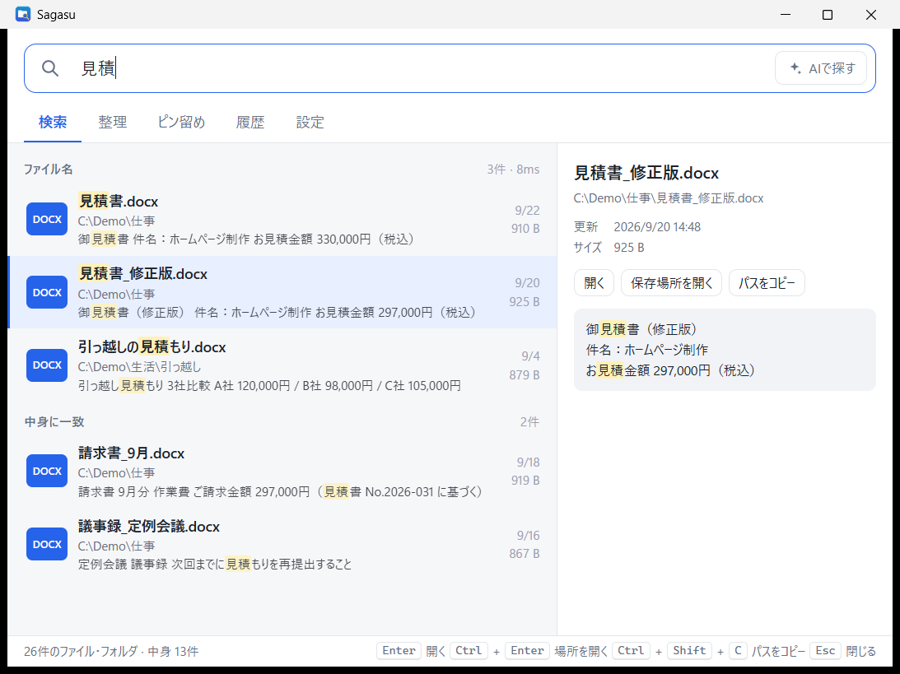
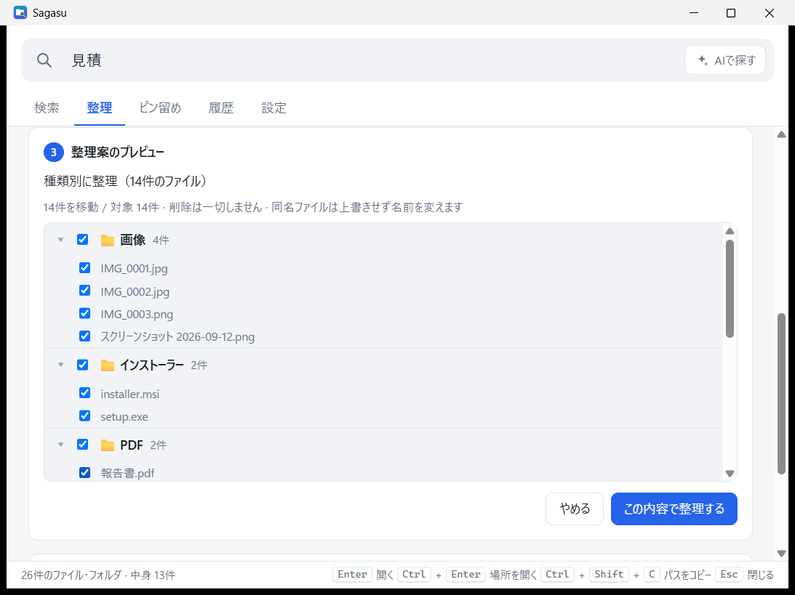

<div align="center">


# Sagasu（さがす）

**名前でも、中身でも、すぐ見つかる。**<br>
**散らかったフォルダは、プレビューしてから安全に片付く。**

[](#-ダウンロードとインストール)
[](CHANGELOG.md)
[](https://tauri.app/)
[](https://www.rust-lang.org/)
[](LICENSE)

[ダウンロード](#-ダウンロードとインストール) ・
[使い方](#-使い方) ・
[整理機能](#-フォルダを整理する) ・
[よくある質問](#-よくある質問) ・
[詳しいガイド](docs/USAGE.md)

<br>



</div>

<br>

## 💡 こんなとき、ありませんか？

| 😣 困りごと | ✨ Sagasu なら |
| --- | --- |
| **名前は覚えているのに、どこに保存したか忘れた** | 名前の一部を打つだけで、パソコン中から一瞬で候補が出ます |
| **名前は覚えていないけど、中身は覚えている** | Word・Excel・PowerPoint・PDF の **本文** まで探せます |
| **深い階層や OneDrive・NAS の、行きにくいフォルダ** | 「経理」など短い **あだ名** を付ければ、打つだけで一番上に出ます |
| **ダウンロードやデスクトップが散らかっている** | 「種類別」などを選ぶだけで整理案を作成。**確認してから** 実行できます |

<br>

## 🌟 主な機能

<table>
<tr>
<td width="50%" valign="top">

### 🔍 すぐ見つかる検索
- 約10万件でも **数十ミリ秒** で表示
- ひらがな・カタカナ・全角・半角・ローマ字の違いを気にせず検索
- 少しの打ち間違いも拾う **あいまい検索**
- よく開くファイルほど上に表示

</td>
<td width="50%" valign="top">

### 📄 中身まで探せる
- Word / Excel / PowerPoint / PDF / テキストの本文を検索
- 一致した部分をハイライトしてプレビュー
- Shift_JIS の古いテキストにも対応
- ファイルの追加・変更は自動で反映

</td>
</tr>
<tr>
<td valign="top">

### 🗂️ 安全に片付く整理
- 種類別・年/月別・年別・拡張子別をワンクリック
- **移動前にプレビュー**、ファイル単位で外せる
- いつでも **元に戻せる** 履歴つき

</td>
<td valign="top">

### ⚡ いつでも呼び出せる
- `Alt+Space` でどの画面からでも表示
- タスクトレイに常駐、Windows 起動時の自動起動
- ピン留め・あだ名で行きにくい場所へ直行
- 重複ファイルを見つけて、ごみ箱へ
- 新しいバージョンがあれば、画面下のボタンから **自動アップデート**

</td>
</tr>
</table>

<br>

## 📥 ダウンロードとインストール

1. [**Releases**](https://github.com/Nishi-Yura/sagasu/releases) から最新の **`Sagasu_x.y.z_x64-setup.exe`** をダウンロード
2. ダウンロードしたファイルをダブルクリックしてインストール（管理者権限は不要です）
3. 起動するとファイルの一覧づくりが始まります。数十秒〜数分で検索できるようになります

> [!TIP]
> **v0.1.0 をお使いの方へ：** v0.1.0 には自動アップデート機能がないため、v0.2.0 は上の手順で一度手動でインストールしてください。以降は、新しいバージョンが出ると画面下のボタンから自動で更新できます。

> [!NOTE]
> Sagasu は電子署名をしていないため、初回に「Windows によって PC が保護されました」と表示されることがあります。
> その場合は **「詳細情報」→「実行」** を押してください。

| 動作環境 | |
| --- | --- |
| OS | Windows 10 / 11（64bit） |
| 必要なもの | Microsoft Edge WebView2（Windows 11 には標準で入っています） |
| インターネット | 更新の確認とダウンロードのときだけ使用します（設定でオフにできます） |

<br>

## 🚀 使い方

### 1. 呼び出して、打つ

`Alt+Space` を押して検索欄に入力するだけ。結果は打つたびに更新されます。

### 2. 言葉を組み合わせて絞り込む

| 書き方 | 意味 | 例 |
| --- | --- | --- |
| 言葉を並べる | すべてを含むものを探す（フォルダ名も対象） | `経理 請求書` |
| `今日` `昨日` `今週` `先週` `今月` `先月` `今年` `去年` `最近` | 更新した時期 | `見積 先月` |
| `画像` `写真` `動画` `音楽` `エクセル` `パワポ` | ファイルの種類 | `旅行 写真` |
| `ext:拡張子` | 拡張子で絞る（カンマで複数） | `ext:pdf,docx` |
| `in:フォルダ名` | 場所で絞る | `in:ダウンロード` |
| `after:日付` / `before:日付` | 日付で絞る | `after:2026-04-01` |
| `size>サイズ` / `size<サイズ` | 大きさで絞る | `size>100mb` |
| `type:folder` / `type:file` | フォルダだけ / ファイルだけ | `経理 type:folder` |

### 3. キーボードだけで操作する

| キー | 動作 |
| --- | --- |
| `Alt+Space`（変更可） | Sagasu を呼び出す / 隠す |
| `↑` `↓` | 結果を選ぶ |
| `Enter` | 開く |
| `Ctrl+Enter` | 保存場所をエクスプローラーで開く |
| `Ctrl+Shift+C` | パスをコピー |
| `Ctrl+1`〜`5` | 検索 / 整理 / ピン留め / 履歴 / 設定 |
| `Esc` | 入力を消す・ウィンドウを隠す |

結果を **右クリック** すると「ピン留めに追加」「このフォルダを整理」などのメニューが出ます。

<br>

## 🧹 フォルダを整理する

<div align="center">

</div>

1. **整理するフォルダを選ぶ**（「ダウンロード」「デスクトップ」はボタン一つ）
2. **整理のしかたを選ぶ**
   - 🏷️ プリセット：種類別 / 年/月別 / 年別 / 拡張子別
3. **プレビューを確認** して「この内容で整理する」。不要な移動はチェックを外せます
4. 気に入らなければ **「履歴」→「元に戻す」** で元通り

> [!IMPORTANT]
> **Sagasu はファイルを削除しません。** 整理は「移動」だけで、同じ名前のファイルがあっても上書きせず `名前 (2).pdf` のように名前を変えます。
> `C:\Windows`・`Program Files`・`AppData`、ドライブ直下、ユーザーフォルダ直下は整理できないようにしています。

<br>

## 🔒 プライバシーと安全

- 🏠 検索用の一覧（インデックス）は **パソコンの中だけ**（`%APPDATA%\jp.sagasu.app`）に保存
- ☁️ OneDrive の「オンラインのみ」のファイルは、勝手にダウンロードしないよう中身を読みません
- 🗑️ ファイルを削除しません。重複ファイルの片付けも **ごみ箱へ移動**（ごみ箱から戻せます）
- 📡 インターネットに接続するのは、新しいバージョンがあるかの確認（GitHub）と、更新をクリックしたときのダウンロードだけです。確認は設定でオフにできます
- 🙈 ファイル名や中身を、どこにも送信することはありません

<br>

## ❓ よくある質問

<details>
<summary><b>Alt+Space が効きません</b></summary>

他のアプリ（PowerToys Run など）が同じキーを使っていると登録できません。
「設定」→「呼び出しキー」をクリックして、`Ctrl+Alt+Space` など別の組み合わせを押してから保存してください。

</details>

<details>
<summary><b>探したいファイルが出てきません</b></summary>

- 「設定」→「検索する場所」に、そのファイルがあるフォルダやドライブ（例: `D:\`）が入っているか確認してください
- `.` で始まるフォルダや隠しファイルは既定で対象外です。「隠しファイル・システムファイルも検索する」で含められます
- 中身の検索は、起動直後しばらくは解析中です（画面下に進み具合が表示されます）

</details>

<details>
<summary><b>漢字の読みで探せますか？（「けいり」で「経理」）</b></summary>

いまは対応していません。ひらがな⇔カタカナ、全角⇔半角、ローマ字⇔かなの違いは吸収します。
名前の一部の漢字を入力するか、`in:フォルダ名` でフォルダを絞り込んでください。

</details>

<details>
<summary><b>不具合を報告したい</b></summary>

「設定」→「アップデートとサポート」→「ログフォルダを開く」を押し、`sagasu.log` を報告に添付してください。
ログはパソコンの中だけに保存されます（最大約 2 MB で、古いものは自動的に入れ替わります）。

</details>

<details>
<summary><b>アンインストールしたい</b></summary>

Windows の「設定」→「アプリ」→「インストールされているアプリ」から Sagasu をアンインストールしてください。
検索用のデータも消したいときは `%APPDATA%\jp.sagasu.app` フォルダを削除してください。

</details>

<br>

## 🛠️ ソースからビルド

```powershell
# 1. Rust（stable / MSVC）を用意して、Tauri CLI を入れる
cargo install tauri-cli --version "^2" --locked

# 2. 開発用に起動
cd src-tauri
cargo tauri dev

# 3. インストーラーを作る（target/release/bundle/nsis と msi に出力）
cargo tauri build

# テスト
cargo test
```

リリース用のビルド（署名付きインストーラーと自動アップデート用の `latest.json`）は `scripts\build-release.ps1` で作れます（更新用の秘密鍵が必要）。

| フォルダ | 中身 |
| --- | --- |
| `src-tauri/src` | Rust のバックエンド（検索インデックス・全文抽出・整理） |
| `ui` | 画面（HTML / CSS / JavaScript、ビルド不要） |
| `docs` | 使い方ガイドと画像 |

<br>

## 📜 ライセンス

[MIT License](LICENSE) © 2026 Nishi-Yura

---

<details>
<summary><b>English</b></summary>

**Sagasu** is a file search launcher for Windows 10/11.

- **Instant name search** across your folders (~100k files in tens of milliseconds), tolerant of hiragana/katakana, full/half width, romaji and small typos.
- **Full-text search** inside Word, Excel, PowerPoint, PDF and text files, with highlighted previews.
- **Safe organizing**: presets (by type, year/month, year, extension); every plan is previewed first, nothing is ever deleted, collisions are renamed, and every run can be undone.
- **Hotkey** `Alt+Space`, tray icon, pins/aliases, duplicate finder (moves copies to the Recycle Bin).
- **Auto-update**: checks GitHub Releases at startup and installs signed updates with one click. Can be turned off in Settings.
- **Privacy**: the index stays on your PC. The app connects to the internet only to check for and download updates. File names and contents are never sent anywhere.
- **Logs**: `sagasu.log` stays on your PC; open the log folder from Settings → Updates & Support when reporting a bug.
- **Install**: download `Sagasu_x.y.z_x64-setup.exe` from [Releases](https://github.com/Nishi-Yura/sagasu/releases). The installer is unsigned; on the SmartScreen prompt choose "More info" → "Run anyway". Users of v0.1.0 need to install v0.2.0 manually once; updates are automatic after that.

</details>
