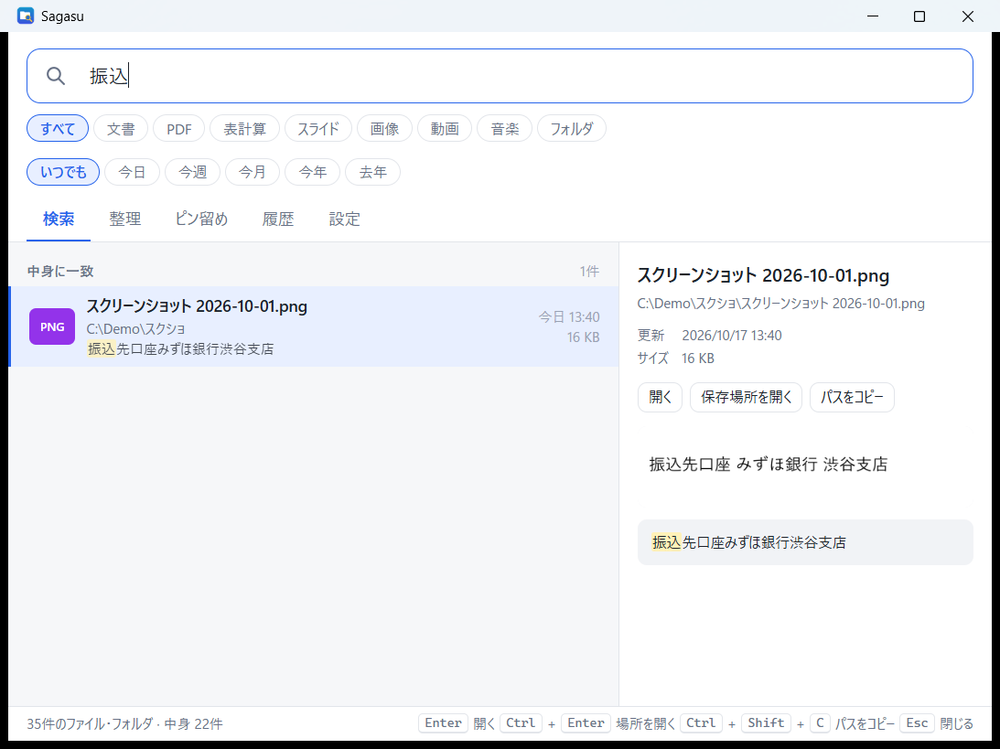
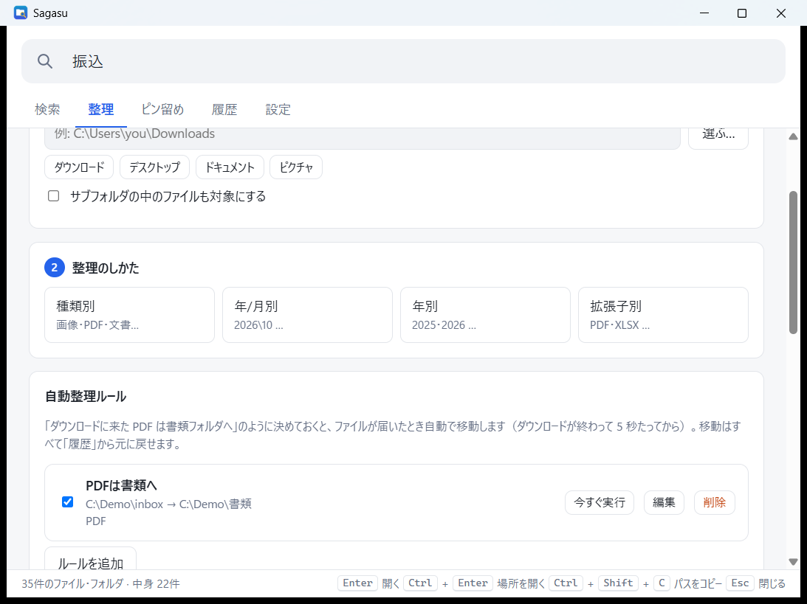

<div align="center">


# Sagasu（さがす）

**名前でも、中身でも、すぐ見つかる。**<br>
**散らかったフォルダは、プレビューしてから安全に片付く。**

[](#-ダウンロードとインストール)
[](CHANGELOG.md)
[](https://tauri.app/)
[](https://www.rust-lang.org/)
[](LICENSE)

[ダウンロード](#-ダウンロードとインストール) ・
[使い方](#-使い方) ・
[整理機能](#-フォルダを整理する) ・
[よくある質問](#-よくある質問) ・
[詳しいガイド](docs/USAGE.md)

<br>


</div>

<br>

## 💡 こんなとき、ありませんか？

| 😣 困りごと | ✨ Sagasu なら |
| --- | --- |
| **名前は覚えているのに、どこに保存したか忘れた** | 名前の一部を打つだけで、パソコン中から一瞬で候補が出ます |
| **名前は覚えていないけど、中身は覚えている** | Word・Excel・PowerPoint・PDF の **本文** まで探せます |
| **漢字の名前が出てこない** | 「けいり」と打てば「経理」、「みつもり」と打てば「見積書」が出ます（**読みで探す**） |
| **スクリーンショットや、スキャンした画像を探したい** | 写っている **文字** で探せます。「振込」と打てば「振込先口座」と写った画像が見つかります |
| **深い階層や OneDrive・NAS の、行きにくいフォルダ** | 「経理」など短い **あだ名** を付ければ、打つだけで一番上に出ます |
| **ダウンロードやデスクトップが散らかっている** | 「種類別」などを選ぶだけで整理案を作成。**確認してから** 実行できます。よく使う片付けは **自動整理ルール** にしておけます |

<br>

## 🌟 主な機能

<table>
<tr>
<td width="50%" valign="top">

### 🔍 すぐ見つかる検索
- 約10万件でも **数十ミリ秒** で表示
- ひらがな・カタカナ・全角・半角・ローマ字の違いを気にせず検索
- **読みで探す**：「けいり」で「経理」、「みつもり」で「見積書」
- 少しの打ち間違いも拾う **あいまい検索**
- **絞り込みボタン** で種類と期間をワンタッチで選べる
- 空欄のとき、**最近の検索** から選び直せる
- よく開くファイルほど上に表示

</td>
<td width="50%" valign="top">

### 📄 中身まで探せる
- Word / Excel / PowerPoint / PDF / テキストの本文を検索
- **画像の中の文字** も検索（スクリーンショット・スキャン）
- 一致した部分をハイライトしてプレビュー
- 画像は **サムネイル** でプレビュー
- Shift_JIS の古いテキストにも対応
- ファイルの追加・変更は自動で反映

</td>
</tr>
<tr>
<td valign="top">

### 🗂️ 安全に片付く整理
- 種類別・年/月別・年別・拡張子別をワンクリック
- **移動前にプレビュー**、ファイル単位で外せる
- **自動整理ルール**：ダウンロードに来たファイルを、決めたフォルダへ自動で移動
- **大きいファイル** の一覧から、不要なものをごみ箱へ
- いつでも **元に戻せる** 履歴つき

</td>
<td valign="top">

### ⚡ いつでも呼び出せる
- `Alt+Space` でどの画面からでも表示
- タスクトレイに常駐、Windows 起動時の自動起動
- ピン留め・あだ名で行きにくい場所へ直行
- 重複ファイルを見つけて、ごみ箱へ
- 新しいバージョンがあれば、画面下のボタンから **自動アップデート**

</td>
</tr>
</table>

<br>

## 📊 動作の目安（参考値）

| 対象 | 一覧の作成 | メモリ | 検索 |
| --- | --- | --- | --- |
| ユーザーフォルダ（約10万件） | 1 秒未満 | 約 60 MB | 約 10〜20 ms |
| Cドライブ全体（Windows を含む・約150万件） | 数十秒 | 約 420 MB | 最大 約 80 ms |

> [!NOTE]
> 上の数値は参考値です。パソコンの性能や、ファイルの数・場所によって変わります。既定の検索場所はユーザーフォルダです。

<br>

## 📥 ダウンロードとインストール

1. [**Releases**](https://github.com/Nishi-Yura/sagasu/releases) から最新の **`Sagasu_x.y.z_x64-setup.exe`** をダウンロード
2. ダウンロードしたファイルをダブルクリックしてインストール（管理者権限は不要です）
3. 起動するとファイルの一覧づくりが始まります。数十秒〜数分で検索できるようになります

> [!TIP]
> **v0.1.0 をお使いの方へ：** v0.1.0 には自動アップデート機能がないため、v0.5.0 は上の手順で一度手動でインストールしてください。以降は、新しいバージョンが出ると画面下のボタンから自動で更新できます。

> [!NOTE]
> Sagasu は電子署名をしていないため、初回に「Windows によって PC が保護されました」と表示されることがあります。
> その場合は **「詳細情報」→「実行」** を押してください。

| 動作環境 | |
| --- | --- |
| OS | Windows 10 / 11（64bit） |
| 必要なもの | Microsoft Edge WebView2（Windows 11 には標準で入っています） |
| 読みで探す・画像の文字認識 | Windows の日本語入力（MS-IME）と、Windows の文字認識（どちらも Windows に標準で入っている機能を使います） |
| インターネット | 更新の確認とダウンロードのときだけ使用します（設定でオフにできます） |

<br>

## 🚀 使い方

### 1. 呼び出して、打つ

`Alt+Space` を押して検索欄に入力するだけ。結果は打つたびに更新されます。

### 2. 言葉を組み合わせて絞り込む

| 書き方 | 意味 | 例 |
| --- | --- | --- |
| 言葉を並べる | すべてを含むものを探す（フォルダ名も対象） | `経理 請求書` |
| `今日` `昨日` `今週` `先週` `今月` `先月` `今年` `去年` `最近` | 更新した時期 | `見積 先月` |
| `画像` `写真` `動画` `音楽` `エクセル` `パワポ` | ファイルの種類 | `旅行 写真` |
| `ext:拡張子` | 拡張子で絞る（カンマで複数） | `ext:pdf,docx` |
| `in:フォルダ名` | 場所で絞る | `in:ダウンロード` |
| `after:日付` / `before:日付` | 日付で絞る | `after:2026-04-01` |
| `size>サイズ` / `size<サイズ` | 大きさで絞る | `size>100mb` |
| `type:folder` / `type:file` | フォルダだけ / ファイルだけ | `経理 type:folder` |

### 3. 漢字の読みで探す

ひらがなで打つと、漢字の名前のファイルやフォルダも見つかります。ローマ字で打っても、かなに変換して探します。

| 打つ言葉 | 見つかるもの |
| --- | --- |
| `けいり` | 「経理」 |
| `みつもり` | 「見積書.docx」 |

- Windows の日本語入力（MS-IME）を使って読みを取得します。Windows の日本語入力が使える環境でのみ動きます
- 最初のスキャンのあと、読みはバックグラウンドで準備され、画面下に「読みを準備中 x / y」と表示されます。準備したものは保存され、次回からも使えます
- 漢字で入力した検索は、これまでどおり動きます

### 4. 種類と期間のボタンで絞り込む

検索欄の下に、ボタンが 2 段並んでいます。

| 段 | ボタン |
| --- | --- |
| 種類 | すべて / 文書 / PDF / 表計算 / スライド / 画像 / 動画 / 音楽 / フォルダ |
| 期間 | いつでも / 今日 / 今週 / 今月 / 今年 / 去年 |

- 言葉を打たなくても使えます。たとえば検索欄を空にして「画像」と「今週」を選ぶと、今週の画像が一覧に出ます
- 言葉を打っているときは、その言葉に加えて絞り込まれます

### 5. 画像の中の文字で探す

スクリーンショットやスキャンした画像（png、jpg、jpeg、bmp、gif、tif、tiff）は、写っている文字も検索できます。文字の認識には Windows に入っている文字認識（OCR）を使います。無料で、インターネットに接続せずに動きます。

<div align="center">

</div>

- 右側のプレビューには、画像そのものと、認識された文字が表示されます
- 文字の認識は完璧ではありません。読み間違いがあることがあります
- 設定の「中身の検索」で、この機能のオン / オフを切り替えられます（[詳しいガイド](docs/USAGE.md)を参照）

### 6. 最近の検索から選び直す

検索欄が空のとき、「最近の検索」に直近の検索語が最大 12 件並びます。ボタンを押すと、その検索をやり直せます。「履歴を消す」を押すと、一覧を消せます。

- 検索履歴に残るのは、検索のあとにファイルを開いたときの検索語だけです
- 検索履歴はこのパソコンの中だけに保存されます

### 7. キーボードだけで操作する

| キー | 動作 |
| --- | --- |
| `Alt+Space`（変更可） | Sagasu を呼び出す / 隠す |
| `↑` `↓` | 結果を選ぶ |
| `Enter` | 開く |
| `Ctrl+Enter` | 保存場所をエクスプローラーで開く |
| `Ctrl+Shift+C` | パスをコピー |
| `Ctrl+1`〜`5` | 検索 / 整理 / ピン留め / 履歴 / 設定 |
| `Esc` | 入力を消す・ウィンドウを隠す |

結果を **右クリック** すると「ピン留めに追加」「このフォルダを整理」などのメニューが出ます。

<br>

## 🧹 フォルダを整理する

<div align="center">

</div>

1. **整理するフォルダを選ぶ**（「ダウンロード」「デスクトップ」はボタン一つ）
2. **整理のしかたを選ぶ**
   - 🏷️ プリセット：種類別 / 年/月別 / 年別 / 拡張子別
3. **プレビューを確認** して「この内容で整理する」。不要な移動はチェックを外せます
4. 気に入らなければ **「履歴」→「元に戻す」** で元通り

> [!IMPORTANT]
> **Sagasu はファイルを削除しません。** 整理は「移動」だけで、同じ名前のファイルがあっても上書きせず `名前 (2).pdf` のように名前を変えます。
> `C:\Windows`・`Program Files`・`AppData`、ドライブ直下、ユーザーフォルダ直下は整理できないようにしています。

### 🤖 自動整理ルール

よく行う片付けを **ルール** にしておくと、ファイルが届いたときに自動で移動します。

<div align="center">

</div>

- 見張っているフォルダに、条件に合うファイルが直接置かれ、そのファイルが **5 秒間変化しなくなったら** 移動先へ動かします（ダウンロードの完了を待つためです）
- 途中まで保存されたファイル（`.crdownload`、`.part`、`.tmp` など）、隠しファイル、Office の一時ファイル（`~$`）は移動しません
- 同じ名前のファイルがあっても上書きせず、`名前 (2).pdf` のように名前を変えます
- 自動で移動したものはすべて「履歴」に「自動整理ルール「名前」」として残り、元に戻せます
- 各ルールには **「今すぐ実行」**（フォルダにすでにあるファイルを、確認のあとで移動）、**「編集」**、**「削除」**、オン / オフのチェックボックスがあります
- システムフォルダは見張り先・移動先に使えません
- 別のドライブへの移動にも対応しています（コピーして、サイズを確かめてから元のファイルを削除します）

**作り方の例：「ダウンロードに来た PDF を 書類 フォルダへ」**

1. 「整理」タブの「自動整理ルール」カードで **「ルールを追加」** を押す
2. **名前** に「PDFは書類へ」などわかりやすい名前を入れる
3. **見張るフォルダ** に「ダウンロード」を指定する
4. **種類** で「PDF」にチェックを入れる（どれもチェックしないと、すべての種類が対象になります）
5. **名前に含む言葉** は空欄のままにする（空欄なら、名前に関係なく対象になります）
6. **移動先** に「書類」フォルダを指定する
7. 内容を確かめて「ルールを保存」を押す

### 📦 大きいファイルを探す

「整理」タブの「大きいファイルを探す」カードには、大きいファイルの上位 100 件が並びます。

- 対象は、ページ上部のフォルダ欄に入れたフォルダの中です。フォルダ欄が空なら、検索する場所すべてが対象になります
- 各ファイルの **「場所」** で、エクスプローラーに場所を開けます
- 不要なファイルは **「ごみ箱へ」** で移動できます（ごみ箱から元に戻せます）

<br>

## 🔒 プライバシーと安全

- 🏠 検索用の一覧（インデックス）は **パソコンの中だけ**（`%APPDATA%\jp.sagasu.app`）に保存
- ☁️ OneDrive の「オンラインのみ」のファイルは、勝手にダウンロードしないよう中身を読みません
- 🖼️ 読みの取得や画像の文字認識は、Windows の機能を使ってパソコンの中で行います
- 🗑️ ファイルを削除しません。重複ファイルの片付けも **ごみ箱へ移動**（ごみ箱から戻せます）
- 📡 インターネットに接続するのは、新しいバージョンがあるかの確認（GitHub）と、更新をクリックしたときのダウンロードだけです。確認は設定でオフにできます
- 🙈 ファイル名や中身を、どこにも送信することはありません

<br>

## ❓ よくある質問

<details>
<summary><b>Alt+Space が効きません</b></summary>

他のアプリ（PowerToys Run など）が同じキーを使っていると登録できません。
「設定」→「呼び出しキー」をクリックして、`Ctrl+Alt+Space` など別の組み合わせを押してから保存してください。

</details>

<details>
<summary><b>探したいファイルが出てきません</b></summary>

- 「設定」→「検索する場所」に、そのファイルがあるフォルダやドライブ（例: `D:\`）が入っているか確認してください
- `.` で始まるフォルダや隠しファイルは既定で対象外です。「隠しファイル・システムファイルも検索する」で含められます
- 中身の検索は、起動直後しばらくは解析中です（画面下に進み具合が表示されます）
- ソースコード・ログ・設定ファイルの中身は、「プログラムのソースコード・ログ・設定ファイル（.cs .js .json .log など）の中身も検索する」をオンにしたときだけ検索されます

</details>

<details>
<summary><b>漢字の読みで探せますか？（「けいり」で「経理」）</b></summary>

はい、探せます。Windows の日本語入力（MS-IME）を使って読みを取得します。ひらがなやローマ字で入力すると、漢字の名前のファイルも候補に出ます。
読みは最初のスキャンのあとで準備されるため、準備が終わるまでは見つからないものがあります（画面下の「読みを準備中」の表示が終わるまでお待ちください）。
漢字で入力した検索は、これまでどおり使えます。

</details>

<details>
<summary><b>画像の中の文字が正しく検索できません</b></summary>

文字の認識（OCR）は完璧ではなく、読み間違いがあることがあります。文字がはっきり写っている画像ほど見つかりやすくなります。
「設定」→「中身の検索」で「画像（スクリーンショット・スキャン）の中の文字も検索する」がオンになっているかも確認してください（既定はオンです）。

</details>

<details>
<summary><b>不具合を報告したい</b></summary>

「設定」→「アップデートとサポート」→「ログフォルダを開く」を押し、`sagasu.log` を報告に添付してください。
ログはパソコンの中だけに保存されます（最大約 2 MB で、古いものは自動的に入れ替わります）。

</details>

<details>
<summary><b>アンインストールしたい</b></summary>

Windows の「設定」→「アプリ」→「インストールされているアプリ」から Sagasu をアンインストールしてください。
検索用のデータも消したいときは `%APPDATA%\jp.sagasu.app` フォルダを削除してください。

</details>

<br>

## 🛠️ ソースからビルド

```powershell
# 1. Rust（stable / MSVC）を用意して、Tauri CLI を入れる
cargo install tauri-cli --version "^2" --locked

# 2. 開発用に起動
cd src-tauri
cargo tauri dev

# 3. インストーラーを作る（target/release/bundle/nsis と msi に出力）
cargo tauri build

# テスト
cargo test
```

リリース用のビルド（署名付きインストーラーと自動アップデート用の `latest.json`）は `scripts\build-release.ps1` で作れます（更新用の秘密鍵が必要）。

| フォルダ | 中身 |
| --- | --- |
| `src-tauri/src` | Rust のバックエンド（検索インデックス・全文抽出・読み・画像の文字認識・整理・自動整理ルール） |
| `ui` | 画面（HTML / CSS / JavaScript、ビルド不要） |
| `docs` | 使い方ガイドと画像 |

<br>

## 📜 ライセンス

[MIT License](LICENSE) © 2026 Nishi-Yura

---

<details>
<summary><b>English</b></summary>

**Sagasu** is a file search launcher for Windows 10/11.

- **Instant name search** across your folders (~100k files in tens of milliseconds), tolerant of hiragana/katakana, full/half width, romaji and small typos.
- **Reading search**: type hiragana or romaji to find kanji names (e.g. `けいり` → 経理). Uses the Japanese IME built into Windows; readings are prepared in the background after the first scan.
- **Filter buttons** for file type and period, usable with or without typed words. **Recent searches** are shown when the box is empty.
- **Full-text search** inside Word, Excel, PowerPoint, PDF and text files, with highlighted previews. **Text in images** (screenshots, scans) is recognized with the OCR built into Windows, offline, and is searchable too. Images show a thumbnail in the preview.
- **Safe organizing**: presets (by type, year/month, year, extension); every plan is previewed first, nothing is ever deleted, collisions are renamed, and every run can be undone.
- **Auto-organize rules**: when a matching file lands in a watched folder and stops changing for 5 seconds, it is moved to the destination. Downloads in progress and hidden files are skipped; every automatic move appears in History and can be undone.
- **Large files**: lists the 100 largest files, with buttons to show the location or move a file to the Recycle Bin.
- **Hotkey** `Alt+Space`, tray icon, pins/aliases, duplicate finder (moves copies to the Recycle Bin).
- **Auto-update**: checks GitHub Releases at startup and installs signed updates with one click. Can be turned off in Settings.
- **Privacy**: the index stays on your PC. The app connects to the internet only to check for and download updates. File names and contents are never sent anywhere.
- **Logs**: `sagasu.log` stays on your PC; open the log folder from Settings → Updates & Support when reporting a bug.
- **Install**: download `Sagasu_x.y.z_x64-setup.exe` from [Releases](https://github.com/Nishi-Yura/sagasu/releases). The installer is unsigned; on the SmartScreen prompt choose "More info" → "Run anyway". Users of v0.1.0 need to install the latest version manually once; updates are automatic after that.

</details>
