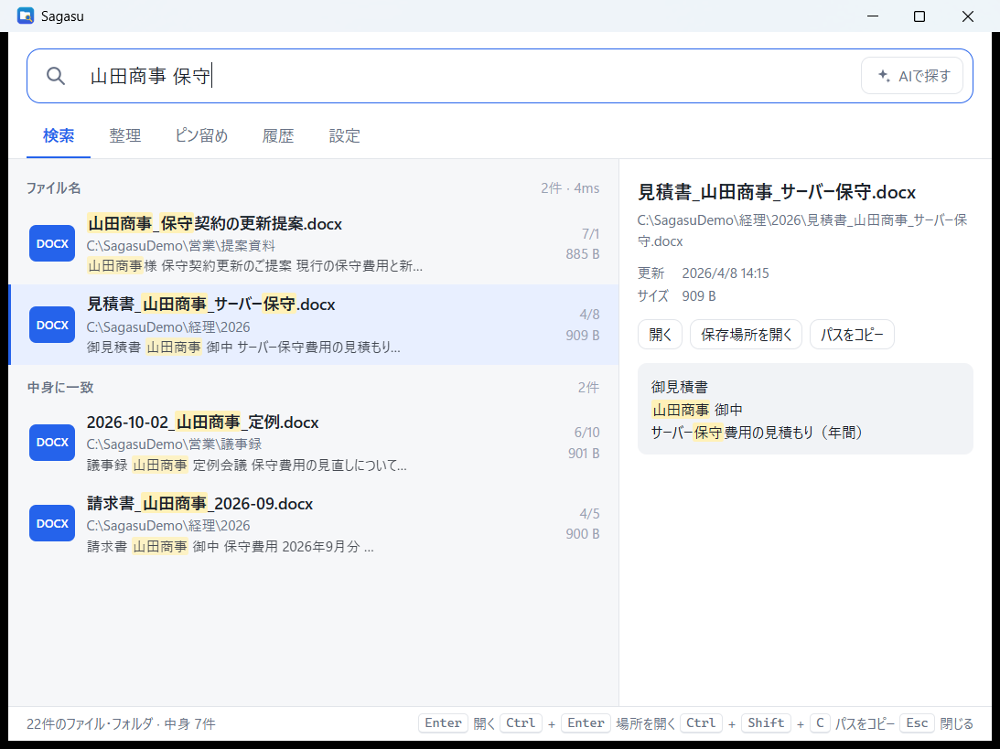

# Sagasu (探す)

「名前でも、中身でも、すぐ見つかる。散らかったフォルダは、AIが片付け案を出す。」

Windows 向けのファイル検索ランチャーです。ファイル名だけでなく、Word / Excel / PowerPoint / PDF / テキストファイルの中身も検索できます。散らかったフォルダは、AI が整理案を出してくれます。



## 概要

- 対象: Windows 10 / 11
- 技術: Tauri v2 + Rust（バックエンド）、HTML / JavaScript（フロントエンド、`ui/`）
- ライセンス: MIT

## 機能

- **ファイル名の即時検索**: 検索する場所（既定はユーザーフォルダ。ドライブ単位でも追加可）を約10万件でも数十ミリ秒で検索。ひらがな / カタカナ、全角 / 半角、ローマ字からの入力にも対応したあいまい検索
- **中身の全文検索**: Word / Excel / PowerPoint / PDF / テキストファイルの本文を検索
- **絞り込み**: `ext:pdf` や `in:フォルダ名` などの検索構文、日付・サイズ指定
- **自然文検索（任意）**: Claude を使った自然文での検索（Anthropic API キーが必要）
- **グローバルホットキー**: 既定は `Alt+Space`（設定で変更可能）でランチャーを呼び出し
- **ピン留め・エイリアス**: 「経理」のような短い別名を入力すると、対応フォルダへ直接移動
- **検索場所の追加**: OneDrive、NAS、外付けドライブを検索対象に追加可能
- **AI 整理**: 「種類別に整理して」のように指示し、移動前後の計画をプレビュー → 承認 → 実行
- **ルールプリセット**: 種類別、年月別などの整理ルールを AI なしで利用可能
- **取り消し履歴**: 整理操作はすべて元に戻せる
- **重複ファイル検出**: 中身がまったく同じファイルを探し、不要なコピーをごみ箱へ（ごみ箱から戻せます）
- **プレビュー**: 選んだファイルの中身（一致した箇所の周辺）やフォルダの中身をその場で表示
- **タスクトレイ常駐・自動起動**: ウィンドウを閉じても常駐し、Windows 起動時に自動で立ち上げることも可能
- **安全設計**: ファイルは削除しません（移動のみ）。同名ファイルは上書きせずリネームします。`C:\Windows`、`Program Files`、`AppData` などのシステムフォルダは整理対象外です。

## インストール

1. [Releases](https://github.com/Nishi-Yura/sagasu/releases) から最新の `Sagasu_x.y.z_x64-setup.exe` をダウンロードします。
2. インストーラーを実行します。
3. 署名されていないアプリのため、Windows SmartScreen の警告が表示される場合があります。その場合は「**詳細情報**」→「**実行**」を選択してください。

## 使い方

### 基本操作

- `Alt+Space`（既定値）でランチャーを開きます。
- 検索語を入力すると、結果がリアルタイムに表示されます。
- 別名（例: 「経理」）を入力すると、登録したフォルダに直接移動できます。

### 検索構文

| 構文 | 意味 | 例 |
| --- | --- | --- |
| `ext:拡張子` | 拡張子で絞り込み | `ext:pdf` |
| `in:フォルダ名` | フォルダ名で絞り込み | `in:経理` |
| `after:日付` | 指定日以降 | `after:2026-01-01` |
| `before:日付` | 指定日以前 | `before:2026-06-30` |
| `size>サイズ` / `size<サイズ` | サイズで絞り込み | `size>10mb` |
| `type:folder` / `type:file` | フォルダだけ / ファイルだけ | `経理 type:folder` |
| 日付語 | 相対的な期間 | `今週` `先月` `去年` |
| 種類語 | ファイルの種類 | `画像` `写真` `動画` `エクセル` `パワポ` `PDF` |

日付語は 今日 / 昨日 / 一昨日 / 今週 / 先週 / 今月 / 先月 / 今年 / 去年 / 最近（2週間）に対応しています。
組み合わせ例: `請求書 先月 PDF in:経理`

### キーボード操作

| キー | 動作 |
| --- | --- |
| `Alt+Space`（変更可） | どこからでも Sagasu を呼び出す / 隠す |
| `↑` `↓` | 結果を選ぶ |
| `Enter` | 開く |
| `Ctrl+Enter` | 保存場所をエクスプローラーで開く |
| `Ctrl+Shift+C` | パスをコピー |
| `Ctrl+I` | 「AIで探す」に切り替え |
| `Ctrl+1`〜`5` | 検索 / 整理 / ピン留め / 履歴 / 設定 |
| `Esc` | 入力を消す・ウィンドウを隠す |

結果を右クリックすると「ピン留めに追加」「このフォルダを整理」などのメニューが出ます。ウィンドウを閉じてもタスクトレイに常駐し、呼び出しキーで再表示できます。

### ピン留め・エイリアス

よく使うフォルダはピン留めできます。エイリアスを設定すると、短い言葉で素早くフォルダを開けます。

### AI で整理する

1. 整理したいフォルダを指定し、指示を入力します（例: 「種類別に整理して」「年月ごとにまとめて」）。
2. 移動前後の計画がプレビューに表示されます。内容を確認します。
3. 承認すると、ファイルが移動されます。

AI を使わず、種類別や年月別のルールプリセットで整理することもできます。

### 取り消し

整理操作の履歴は保存されており、「取り消し」で元の状態に戻せます。

## AI 機能の設定

AI による自然文検索と整理提案には Anthropic API キーが必要です。AI 機能は任意で、使わなくても検索と整理（ルールプリセット）は利用できます。

1. [https://console.anthropic.com/](https://console.anthropic.com/) で API キーを取得します。
2. Sagasu の「設定」を開き、API キーを貼り付けます。

API キーは Windows 資格情報マネージャー（Windows Credential Manager）に保存されます。

## プライバシー

- 検索インデックスは、ローカルの `%APPDATA%\jp.sagasu.app` に保存されます。
- AI 機能を使う場合のみ、ファイル名とメタデータが AI に送信されます。ファイルの中身は送信されません。
- API キーは Windows 資格情報マネージャーに保存されます。

## ソースからビルド

1. Rust（stable、MSVC ツールチェーン）をインストールします。
2. Tauri CLI をインストールします。

   ```powershell
   cargo install tauri-cli --version "^2" --locked
   ```

3. `src-tauri` ディレクトリで実行します。

   ```powershell
   cd src-tauri
   cargo tauri dev     # 開発実行
   cargo tauri build   # リリースビルド
   ```

インストーラーは `src-tauri/target/release/bundle/{nsis,msi}` に出力されます。

## ライセンス

MIT License. Copyright (c) 2026 Nishi-Yura. 詳しくは [LICENSE](LICENSE) を参照してください。

---

## English

**Sagasu (探す)** is a file search launcher for Windows 10/11. It searches file names instantly across drives (fuzzy matching for hiragana/katakana, full/half width, and romaji input), and also searches the contents of Word, Excel, PowerPoint, PDF, and text files. For cluttered folders, an optional AI feature proposes an organization plan that you preview before anything is moved.

- **Hotkey**: `Alt+Space` by default (configurable) opens the launcher.
- **Filters**: `ext:pdf`, `in:folder`, `after:2026-01-01`, `before:...`, `size>10mb`, and date words such as 今週 or 先月.
- **AI (optional)**: natural-language search and organize suggestions. Requires an Anthropic API key from https://console.anthropic.com/, entered in 設定. Only file names and metadata are sent to the AI, and only when you use AI features. The key is stored in Windows Credential Manager.
- **Safety**: files are never deleted, only moved; duplicates are renamed, never overwritten; system folders (C:\Windows, Program Files, AppData) are never organized; all organize operations can be undone.
- **Install**: download `Sagasu_x.y.z_x64-setup.exe` from [Releases](https://github.com/Nishi-Yura/sagasu/releases). The installer is unsigned, so SmartScreen may warn you; choose 「詳細情報」→「実行」 to continue.
- **Build from source**: install Rust (stable, MSVC), run `cargo install tauri-cli --version "^2" --locked`, then in `src-tauri` run `cargo tauri dev` or `cargo tauri build`.
- **License**: MIT. Copyright (c) 2026 Nishi-Yura.
